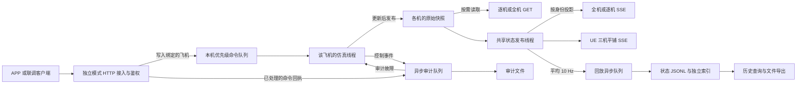

# 后端架构逻辑说明

2026-11-21 · 后端 v0.9 · 独立三机模式 · 统一契约 1.0

本说明依据现有代码及复测更新《后端逻辑架构与改动方案》的运行口径。部署入口是 `run_backend.py --mode independent`。APP 源码核对基准为 PR #4 的 `4dd149a6bd6b541fe7b5b16292180688affc4735`。[GitHub PR #4](https://github.com/czy2024333-spec/AppRemoteControlProject/pull/4)

## 1. 控制、仿真与发布



- `independent_fleet.py` 从凭据确定来源、角色和设备绑定。三架飞机各有仿真线程、控制会话、传感器配置和状态。操纵端只写绑定的飞机，授权的观察端可以读取全部三架。独立模式的运动路由要求显式设备号。
- `app_server.py` 在每架飞机的线程内串行校验会话、`control_epoch`、序号、TTL、来源能力和归中状态，再向 `SimulationCore` 下发。保护和停止优先于普通运动。用户主动申请、切换来源、归中，随后发起新运动。运动报文过期进入 `PROTECTED`，会话心跳只维持租约。
- 仿真线程发布完整快照。GET 读取最近一次快照，SSE 共享一份聚合和历史，再按订阅者身份投影权限。位置、速度、姿态、角速度的 HUD 参考来自仿真真值，带噪测量单独发布，按样本自己的年龄判断有效性。
- 独立模式默认三机各 50 Hz 步进，SSE 目标 25 Hz。每架飞机的线程使用同一套调度实现，以 `time.sleep()` 短等待，单次请求等待不超过 2 ms，到计划时刻推进一个固定仿真步。每轮检查停止、命令和 TTL。异常延迟仍按原判定进入调度保护。调度负载对照在独立三机模式执行，接口回归覆盖其他模式。

## 2. 读取与故障信号

可选的 `gnss` 配置为每个成员建立固定频率的局部定位采样。采样点位于两个动力学步之间时，按步间位置和服务端时刻插值。每成员用独立的两组随机序列分别模拟位置噪声与传输丢包，线性漂移按经过的仿真时间计算。有界队列从采样时刻开始计延迟，统一状态在 `sensors.gnss_local_position` 中分别提供采样和交付时刻。数据年龄包括成员停更时长。地理坐标换算保留为待办。[GNSS 时序、接口与验证](GNSS误差模拟_初步实现.md)

| 用途 | GET 路径 | 字段及行为 |
| --- | --- | --- |
| 能力和绑定 | `/api/v1/capabilities`、`/api/v1/devices` | 返回身份、可写设备、配置来源和能力标志。 |
| 全机总览 | `/api/v1/state`、`/api/v1/events` | 默认完整三机状态。可用 `focus` 显式订阅焦点机，其他成员摘要约 10 Hz。客户端启用前应能按设备合并部分帧。 |
| 单机统一视图 | `/api/v1/devices/{device_id}/state`、`/api/v1/devices/{device_id}/events` | 返回统一状态字段。 |
| 原逐机 HUD 和 UE | `/api/devices/{device_id}/state`、`/api/devices/{device_id}/events` | 返回 `position_m`、`quaternion_xyzw`、`boundary_recovery` 等逐机原字段。 |
| UE 全机状态 | `/api/v1/ue/events` | 三机平铺状态，采用米制局部三维坐标，复用共享发布帧。 |
| 状态回放 | `/api/v1/replay/frames`、`/api/v1/replay/export` | 按录制时间查询和导出逐成员真值，回放记录另提供 UE 厘米坐标。 |
| 健康 | `/api/health` | 返回 `data.boot_id` 和 `data.state_publisher`。`boot_id` 是整个独立服务的启动编号，逐机状态另有各机自己的 `boot_id`。 |

SSE 继续按 `event: state`、`data: ...`、`id: ...`、空行输出。客户端可用 `Last-Event-ID` 恢复同一流最近 50 帧内的数据，超出历史或服务重启时收到重同步注释与最新帧。历史帧带 `replayed=true`。空闲时只有发布线程健康才发送 `: heartbeat`，注释不计为新状态。

回放使用独立队列和索引，默认写入 `results/independent_live/replay/state_frames.jsonl`。录制故障在 `health.data.replay` 中公开，实时控制仍由各机执行器推进。分页按成员记录计数，通过服务启动编号和 `frame_sequence` 归并帧。UE 和 APP 各有续传 ID 前缀。[本轮接口、文件和验证](后端整合说明_回放与UE_20261121.md)

独立 HTTP handler 使用 `HTTP/1.1`。普通成功请求带 `Content-Length`，可复用连接。每条 SSE 连接由自己的 HTTP 线程写入 socket，共享发布线程负责取样和更新历史。停止读取的客户端会占用自己的写线程，慢订阅者故障注入仍待验证。

发布线程异常退出或达到 1 秒没有完成采样时，健康检查返回 503，`state_publisher.reason` 区分 `STATE_PUBLISHER_FAILED` 和 `STATE_PUBLISHER_STALLED`。已有 SSE 订阅在检测到故障后结束，新订阅返回 HTTP 503 和 `STATE_PUBLISHER_UNAVAILABLE`。卡顿结束且发布恢复推进后可重新订阅。线程退出后需重启服务。快照 GET 直接读取各机已发布状态，仍可用于诊断。[独立模式 OpenAPI](openapi_independent.json)

`state_publisher.cadence` 用最近 50 帧的有界续传历史统计共享取样间隔。它返回目标频率 `target_hz`、间隔样本数 `samples`、取样间隔 P95 和最大值，以及最新一帧的年龄。启动初期样本不足时，相应的时长为 `null`。手机联调时同时记录接收频率、实际相邻接收间隔和 HUD 提交频率，用于定位卡顿发生在哪一段。[发帧复测记录](后端HUD优化实施记录.md)

PR #4 总览和单机 HUD 均独立检查最后一份新状态，超过 500 ms 将连接标为失效，单机 HUD 同时撤销运动通路。总览还跟踪每架飞机的 `boot_id` 和 `sequence`。相同状态或注释心跳都不会续期，因此沿用注释格式，避免旧 APP 尝试将诊断消息解析成飞机状态。[PR #4 固定版本源码](https://github.com/czy2024333-spec/AppRemoteControlProject/tree/4dd149a6bd6b541fe7b5b16292180688affc4735/VrxFusionRemote)

## 3. 契约识别、停止与恢复

`contract_version` 继续使用 `1.0`，兼容 PR #4 的严格版本检查。在 `/api/v1/capabilities` 的 `data.capabilities` 通过布尔值识别支持情况。标志缺失按未声明处理。

| 标志 | 为 `true` 时 |
| --- | --- |
| `hud_state_metadata` | 统一状态包含有效性原因、年龄、保护恢复、目标航向、环境和控制应用元数据。支持这些字段的后端也可能返回 `null`，例如本轮尚未应用运动。 |
| `sse_comment_heartbeat` | 发布健康且没有新帧时发送 SSE 注释心跳。 |
| `sse_resume` | 支持通过 `Last-Event-ID` 有界续传。 |
| `sse_focus` | 支持显式焦点机分流。 |
| `state_publisher_health` | 提供共享发布健康详情和故障断流。 |

- `last_applied` 只记录已执行的运动，控制轮次变化时清空。STOP 执行后推进轮次，正常制动进入 `HOLD`，已经保护时保持 `PROTECTED`。`control_epoch` 变化和模式可用来判断旧运动已被撤销。切换和保护也会推进轮次，确认某条 STOP 时应按原 `command_id` 查询 `/api/v1/devices/{device_id}/commands/app/{command_id}`，以 `phase=COMPLETED` 和 `completion_scope=SERVICE_APPLIED` 为准。它确认后端执行，飞机是否已停稳仍由实际速度判断。同一会话、相同 ID、动作及命令内容的离散重试返回原结果。复审修复了 STOP 的 ID 被 PROTECT 误用时返回 STOP 成功回执的问题。跨动作复用现在返回 `409 COMMAND_ID_REUSED`。
- `protection.recovery` 和旧逐机 `boundary_recovery` 来自同一仿真快照。应以同一设备、`boot_id` 和 `sequence` 比较。边界解除依据实际高度、半径、速度和归中确认。`video.status` 继续为 `NOT_CONNECTED`，实际画面状态由播放器提供。
- 审计写入失败依现有策略保护三机。一次故障只处理一次控制轮次，已有保护原因保留。已有合法会话仍能提交 STOP 和 PROTECT。修复落盘环境并重启后，各机从新启动的 `HOLD` 状态开始，旧会话返回 `STALE_SESSION`。用户需重新申请、切换、归中，再发起新运动。运动遇到 `RETRY_LATER` 时也是等待服务恢复后发起新意图。

### 链路活性契约

- `GET /api/v1/capabilities` 的 `data.link_policy` 提供目标帧率、成员过期年龄、注释心跳间隔、历史帧上限、焦点流的僚机帧率、发布超时和输入 TTL 上限。客户端可分别使用建议的 SSE 读超时与首帧期限，默认各 3000 ms。原 `capabilities` 保持布尔类型。部署的默认成员过期年龄为 500 ms，由 `cluster_config.json` 决定。
- 会话 ACK 提供服务接收和确认的 Unix 毫秒时间。客户端可选传校准后的 `client_sent_at_ms` 检查会话时间窗口，超限返回 `CLOCK_SYNC_REQUIRED`，在替换会话前返回。普通指令沿用 `sent_at_ms` 和 `ttl_ms`，在接收时扣除报文年龄，在执行前继续扣除服务端排队时间。错误详情区分超前、到达时过期和排队中过期。接收年龄包含时钟偏差与网络耗时。
- `control.epoch_reason` 对应原始字段 `control_epoch_reason`，固定在同一轮次内。`SESSION_REPLACED` 表示同来源会话替换，`STOP_APP` 表示 APP 停止已推进轮次。STOP 回执丢失后先停发，按原 ID 查回执，从最新状态读轮次和模式，再以用户新操作建立运动意图。[前端对接流程](前端对接_三机独立操控.md)

## 4. Windows 调度复测

本机为 Windows 11 build 26200、CPython 3.13.14。请求 2 ms 等待，独立探针每种方式做 3 组、每组 80 次。`Event.wait()` 各组中位数为 10.19、10.26、10.36 ms，`time.sleep()` 为 2.27、2.18、2.23 ms。CPython 的 `Event.wait()` 走带超时的条件等待，Windows 的 `time.sleep()` 走等待计时器。探针和负载对照支持短等待是本机抖动的主要来源，实际唤醒仍受线程调度影响。[Python time.sleep 文档](https://docs.python.org/3.13/library/time.html#time.sleep) · [CPython threading 实现](https://github.com/python/cpython/blob/v3.13.14/Lib/threading.py)

每组 60 秒，两种等待各运行三轮并交替顺序。两组共用同一后端代码、三个 50 Hz 仿真实例、三路约 20 Hz HTTP 操纵和四路全机 SSE。步长抖动为相邻实际步进间隔相对 20 ms 的绝对偏差。下表每格为三轮的最小值／中位数／最大值。

| 指标 | 原 `Event.wait()` | 改为 `time.sleep()` |
| --- | ---: | ---: |
| 1 号机步长抖动 p99（ms） | 14.87 / 15.12 / 15.13 | 0.90 / 1.01 / 1.22 |
| 2 号机步长抖动 p99（ms） | 15.91 / 16.28 / 16.50 | 0.77 / 0.96 / 1.09 |
| 3 号机步长抖动 p99（ms） | 16.22 / 16.81 / 17.92 | 0.74 / 1.06 / 1.14 |
| 1 号机 HTTP 往返回执 p95（ms） | 17.97 / 18.40 / 18.75 | 4.72 / 4.79 / 4.82 |
| 2 号机 HTTP 往返回执 p95（ms） | 17.29 / 17.92 / 18.16 | 4.74 / 4.85 / 4.90 |
| 3 号机 HTTP 往返回执 p95（ms） | 18.02 / 18.40 / 18.77 | 4.70 / 4.73 / 5.00 |
| 四路 SSE 实收（Hz，各端同值） | 24.98 / 25.00 / 25.00 | 24.98 / 25.00 / 25.02 |

六轮均通过。改后组确认 10,712 条运动请求，各轮各控制端 p95 均低于 100 ms，各观察端均高于 20 Hz。这组测量覆盖本机 Python 客户端发出请求至收到回执的往返时间和 SSE 实收率。APP 在手机上的 HUD 刷新、实际局域网延迟及长时稳定性需分别测量。[六轮原始统计摘要](../docs/validation/后端HUD_20261112_验证摘要.json)

在后端目录用 `drone-sim-backend` 解释器复测。

```powershell
python benchmark_scheduler.py --rounds 3 --seconds 60 --out results/scheduler-ab-repeat
python run_checks.py
```

## 5. 运行环境自检

`run_backend.py` 在启动前检查解释器、依赖、实际配置和凭据，并实测 31 次 2 ms 短等待。启动最低版本为 3.11，本机依赖锁的 NumPy 和 SciPy 需要 3.12 起。本机 CPython 3.13.14 的短等待中位数约为 2.03–2.05 ms。全网卡监听遇到公开示例 Token、短等待过慢或审计磁盘空间异常时，JSON 会给出对应告警。独立模式自检同时读取审计文件体积和所在卷的剩余空间。[运行环境自检](后端运行环境自检.md)

每架飞机的每个来源会话保留 1024 条普通离散命令，并单独滚动保留最近 64 条 STOP、PROTECT 和 DISCONNECT 回执。普通历史满时合法安全动作仍会执行。有效回执按原 ID 查询，换出的旧报文仍受序号约束。`--doctor` 返回两个容量，审计归档步骤和运行期边界见对应自检文档。[第三轮安全命令复测](后端第三轮自检_安全命令历史.md)

逐机队列总容量为 140。普通请求的入队阈值为 128，STOP 和断连再有 8 个位置，PROTECT 和内部屏障再有 4 个位置。旧集群的普通批量历史容量为 2048，纯安全批次每来源会话独立滚动保留 64 条结果。[第四轮自检](后端第四轮自检.md)

## 6. 回归与待联调问题

- PR #4 的 HUD 后端基线 `c8f030e` 有 131 项回归通过。覆盖 SSE 发布线程异常、阻塞和恢复，三种订阅路由故障返回，STOP 回执、幂等和跨动作 ID 复用，审计写入异常与重启后拒绝旧会话，以及同一发布序号的新旧恢复字段一致。[基线后端回归摘要](../docs/validation/后端HUD_20261112_验证摘要.json)
- 链路活性契约回归 135 项全部通过。新增覆盖可选会话时间校验、到达与排队过期诊断、超大整数拒绝、SSE 轮次原因稳定性。STOP 用例验证可通过最新状态取得轮次，旧触摸意图仍被拒绝。[链路活性契约](后端链路活性契约.md) · [上一轮后端回归摘要](../docs/validation/后端三机_20261115_验证摘要.json)
- 第二轮运行环境自检后，后端 142 项回归全部通过。已验证版本门槛、短等待统计、凭据告警和只读存储探测。[第二轮后端回归摘要](../docs/validation/后端三机_20261115_验证摘要.json)
- 第三轮后端 148 项通过，新增用例覆盖普通历史满额、安全回执滚动、外设映射与审计故障。[第三轮后端回归摘要](../docs/validation/后端三机_20261115_验证摘要.json)
- 第四轮后端 152 项通过。队列与旧集群历史达到上限时的安全动作已复测。八路 SSE、三路控制和心跳、健康轮询及日志导出并发的本机 60 秒补测通过。[第四轮报告](后端第四轮自检.md) · 第四轮后端回归见本机 `results/checks/backend.txt`
- 动力学 26 项通过，`test_lab.Day1Tests.test_finished_run_summaries` 的保存结果检查按原条件跳过。该项默认只在 `ROTORPY_CHECK_SAVED_RESULTS=1` 时开启，并依赖先生成的官方示例、悬停和恢复报告及部分 `states.npz`。用 `core/run_official.py`、`core/run_lab.py --case all` 生成结果后可单独启用。动力学回归见本机 `results/checks/dynamics.txt`
- PR #4 的固定 APP 提交 `4dd149a` 在本轮有 26 项 JVM 回归通过，含本地附加用例。新增兼容用例用该提交的解码器读取本轮真实 HTTP 响应，覆盖数值链路参数与轮次原因。
- UE 的 `CsaBackendSseClient.cpp` 按字段名前缀读取，遇到空行才解析状态，`id` 和注释的行序不影响解析。源码显示它先从 `/api/health` 读取 `boot_id`，后端已补齐，并已通过实际 HTTP 检查 `boot_id` 和单机流的字段。UE 默认订阅 `/api/events`，独立三机联调时将 UE 的 `EventsPath` 配置为 `/api/devices/<设备号>/events` 并使用对应部署的授权凭据。当前桥接解析一架飞机的原始状态。UE 引擎端运行仍待联调。
- 旧白名单联调页的脚本已用两种 `id` 位置和注释心跳验证，能正常取出 `data:`。页面只提供单机和旧集群路径，独立模式的全机读取使用 `/api/v1/state` 和 `/api/v1/events`。旧页面也缺少独立的数据过期判断。
- PR #4 仍使用完整帧，逐项有效性、续传和焦点分流尚待 APP 接入。重连时在 `connected=false` 的阶段没有单独的首帧期限。APP 流式读超时关闭，如果网络静默挂住，500 ms 状态判断可能无法取消这次重连。后端现提供建议时限，APP 消费和断网测试待联调。
- 五个方向按原文编号记录实现、验证和待办状态。[后端优化清单自检进度](后端优化清单自检进度.md)
