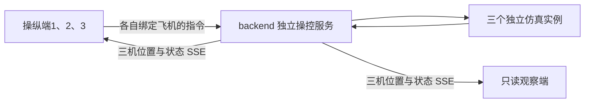

# 仓库目录与分工

本仓库包含两个工程。Android Studio 打开 VrxFusionRemote/，VS Code 和 Python 终端打开 backend/；从仓库根目录运行后端前先 cd backend。

## 负责人和改动范围

| 角色 | 主要职责 | 日常改动目录 | 交接材料 |
| --- | --- | --- | --- |
| A：后端/仿真负责人 | 动力学、逐机会话、权限、保护、状态发布、日志和接口 | backend/ | 接口契约、配置样例、回归及性能结果 |
| B：前端负责人 | Android 界面、摇杆/事件采样、三机显示、控制握手和状态过期提示 | VrxFusionRemote/ | APK 构建、UI/输入日志、实际手机刷新统计 |
| C：UE 负责人 | 场景、模型、画面、坐标转换和渲染接入 | UE 工程另行提供 | UE 接口、坐标映射、构建与画面联调记录 |
| 联调与测试 | 核对版本、网络、契约、时序和验收边界 | docs/，以及各工程测试 | 同时段前后端日志与复现条件 |

角色字母沿用项目分工，不自动等同 GitHub 账号或仓库权限。实际协作人员加入后再绑定评审人，不预设不存在的账号。

## 目录说明

- VrxFusionRemote/app/：当前 Android APP。
- VrxFusionRemote/tools/pc_camera/：前端侧可选电脑摄像头工具，按工具说明启动。
- VrxFusionRemote/server/：历史 WebSocket 协议测试工具，不是当前三机后端。
- backend/：当前三机独立操控服务、Python 核心、配置、测试和协议。
- backend/core/cpp/：自写 C++ 核心源码。
- backend/core/ue/：历史 UE 桥接组件/工程骨架；不代表甲方 UE 工程或当前视频验收。
- backend/core/vendor/：带来源和许可证的第三方固定阅读源码；不要在这里修改应用业务。
- docs/validation/：经过整理的历史摘要；新测试输出先保存在本机 results，再提交必要的脱敏报告。

## 当前数据和控制关系

控制参数、来源、会话、序号、epoch、TTL 和保护由后端校验；前端负责用户意图、实际归中采样与显示。读取状态不授予控制权；一个端只写本机，所有端可读三机。位置为同一仿真世界坐标的米，前端或 UE 转换显示不能改写接口单位。

## 历史边界

旧 single/cluster/unified 模式保留给旧协议回归；当前三端并行各控一机用 independent。旧版文档标题中的版本号表示历史内容，优先以当前 README 和三机接口说明为准。

分支 czy2024333-spec-drone-vertical-dynamics 含旧 vertical_dynamics 模块，不是当前完整三维后端，未在本次整理中合并或删除。仓库也未包含真实硬件 SDK、签名私钥、已安装 UE 或供应商工程。
